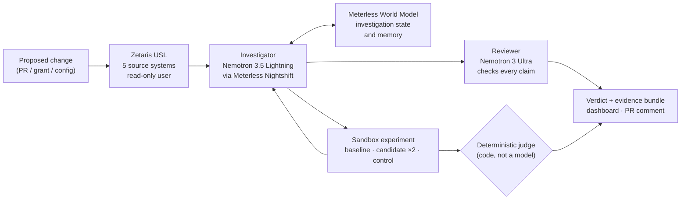

# Domino

**Domino finds the test nobody thought to write, runs it before deployment, and shows exactly what would break, with evidence rather than a guess.**

Domino is an autonomous, evidence-first **pre-deployment failure investigation agent**. Given a proposed change (a pull request, permission grant, schema migration or config edit), it joins the facts about that change that are scattered across separate systems, works out which hidden cross-system assumption the change could break, and then proves or rules out each one with a controlled experiment in a disposable sandbox, before anyone deploys.

## Submission links

| | |
|---|---|
| **Demo video (1–4 min)** | **TODO:** link |
| **Live demo (dashboard)** | **TODO:** link |
| **Slide deck** | **TODO:** link |
| **Repository** | https://github.com/alleti01/Domino |

| | |
|---|---|
| **Event** | GenAI.Works Open Agent Hackathon 2026 |
| **Track** | Track 1: Solving Fragmented Intelligence |
| **Built** | 22–27 October 2026 |
| **Team** | Anish Alleti · Abhi Jandyala · Adhvik Vala |
| **Sponsor stack** | Zetaris · Meterless Nightshift · Meterless World Model · NVIDIA Nemotron · NVIDIA Nemotron Ultra |

---

## Contents
- [The problem](#the-problem)
- [What Domino does](#what-domino-does)
- [How it works](#how-it-works)
- [Sponsor technology in Domino](#sponsor-technology-in-domino): [Zetaris](#zetaris-one-view-across-five-systems), [Meterless Nightshift](#meterless-nightshift-every-model-call-on-the-record), [Meterless World Model](#meterless-world-model-the-agents-memory), [NVIDIA Nemotron](#nvidia-nemotron-the-investigator), [NVIDIA Nemotron Ultra](#nvidia-nemotron-ultra-the-independent-reviewer)
- [AI coding tools (Cursor, Claude Code)](#ai-coding-tools-cursor-claude-code)
- [Results](#results)
- [Try it](#try-it)
- [Repository structure](#repository-structure)
- [Safety, privacy and data](#safety-privacy-and-data)
- [Limitations](#limitations)
- [Pre-existing components and what we built](#pre-existing-components-and-what-we-built)
- [Team](#team)
- [Roadmap](#roadmap)

---

## The problem

Teams test the file they changed. Catastrophic incidents often start in a system nobody thought to test, because the change was **correct in isolation and disastrous in combination**.

- **Cloudflare, 18 November 2025.** A database permissions change altered the output of a metadata query. A generated file grew past a downstream consumer's limit. ([official postmortem](https://blog.cloudflare.com/18-november-2025-outage/))
- **CrowdStrike, July 2024.** A content update and the component interpreting it disagreed about how many input fields existed. ([official root-cause analysis](https://www.crowdstrike.com/wp-content/uploads/2024/08/Executive-Summary_Root-Cause-Analysis_Channel-File-291.pdf))

No single artifact held the whole causal chain. The change was in one place, the permissions in another, the generator's behaviour in code, the consumer's limit in configuration and the real data volumes in telemetry. That is **fragmented intelligence**, and it is why this is a Track 1 project: no single source proves the cross-system consequence. A semantic join across them raises the question, and a sandbox experiment answers it.

## What Domino does

An engineer opens a high-impact change. Domino:

1. **Reads the change** and identifies what it touches.
2. **Connects the context** through a Zetaris Unified Semantic Layer (USL) over five independent source systems, keeping the source row behind every fact.
3. **Hypothesizes** specific, falsifiable downstream consequences (NVIDIA Nemotron via Meterless Nightshift).
4. **Experiments:** runs the baseline and the candidate side by side in an isolated test world, changing one thing.
5. **Controls:** reverts the change and checks that the failure goes away.
6. **Reports** a conservative verdict with a reproducible evidence bundle.

| Verdict | Means |
|---|---|
| **Reproduced failure** | baseline passed, the candidate failed twice, and the control (change reverted) passed again |
| **No failure observed** | nothing broke *under the exact conditions listed*; never a claim of production safety |
| **Inconclusive** | the available context or sandbox fidelity was not enough to decide |

**The verdict is decided by code, not a model.** A deterministic judge applies the rule above. Neither Nemotron model can mark anything verified.

The evidence bundle holds the change, the cross-source dependency path with source row IDs, every experiment's parameters and outcome, the model-routing receipts, the reviewer's findings and a suggested (unverified) mitigation. The dashboard renders it as a report and as the PR comment Domino would post.

## How it works



Every investigation is bounded by caps on steps, model calls and wall-clock time.

**Boundaries of autonomy**
- **Typed tool gateway.** No raw shell and no secrets. The agent can run read-only SQL against the USL, look up rows, walk dependency paths and run experiments, each with argument schemas, budgets and timeouts.
- **Citation guard.** A claim can only cite rows, path hops and experiments returned in the same run.
- **Two-source rule.** Every cross-source link rests on facts from independent systems and is labelled *observed*, *inferred* or *unresolved*.
- **Read-only context.** The agent reads Zetaris as a non-admin user who can see only the USL. It writes nothing outside disposable sandboxes.

| Component | Responsibility | Owner |
|---|---|---|
| Data layer (`data_layer/`, `zetaris/`) | Zetaris USL over independent sources, data-quality rules, provenance-preserving lookups, sample mode, query log | Anish |
| Test worlds (`worlds/`) | Small, offline, deterministic systems that really break under a specific change | Anish |
| Scorecard (`scorecard/`) | Honest measurement against simpler baselines; leakage checks | Anish |
| Agent (`agent/`) | Investigation loop, tool gateway, judge, reviewer, Nightshift client, World Model | Abhi |
| Dashboard (`ui/`) | Landing page, investigation reports, results, sponsor proof | Adhvik |

The components meet only at the interfaces in [`contracts/`](contracts/README.md): `lookup`, `dependency_path`, `run_experiment`, `describe_world`, `list_tables` and `dq_issues`.

---

## Sponsor technology in Domino

Five sponsor technologies run inside Domino. Each one has a job no other part does.

| Technology | What it does in Domino | Where in the code | Proof |
|---|---|---|---|
| **Zetaris** | Joins five separate source systems into one Unified Semantic Layer (USL) that the agent queries; data-quality rules catch broken links | `zetaris/`, `data_layer/zetaris_client.py` | query log, USL tables, data-quality output, cited source rows |
| **Meterless Nightshift** | The only inference provider: routes every model call to Nemotron and returns a signed receipt naming the model that answered | `agent/src/llm/nightshift.ts`, `agent/src/llm/receipts.ts` | `runs/receipts.jsonl`, `model_call` trace events |
| **Meterless World Model** (open engine) | The agent's investigation state and memory: what it found, where each fact came from, what it suspected and what it confirmed | `agent/src/engines/worldModel.ts`, `agent/vendor/meterless-world-model/` | World Model reads/writes/updates in every run; official conformance suite |
| **NVIDIA Nemotron** (3.5 Lightning) | The investigator: follows the change, forms hypotheses, picks experiments, explains the result | `agent/src/agent.ts` | receipts show `nemotron-3.5-lightning-30b-a3b` on every investigator call |
| **NVIDIA Nemotron Ultra** | The independent reviewer: checks every claim against the evidence before the report ships | `agent/src/critic.ts`, `agent/docs/reviewer-eval.md` | 33 of 33 planted errors caught |

The dashboard's **System proof** page (`#/under-the-hood`) shows the recorded proof for Nemotron via Nightshift, Zetaris and the World Model, taken from the saved runs.

### Zetaris: one view across five systems

**What it is.** A data platform whose Unified Semantic Layer (USL) puts many separate sources behind one SQL interface.

**How Domino uses it.** Zetaris is where the scattered facts about a change become one model the agent can question.
- **One USL over five source systems:** change records, pipeline repo, service catalog, runtime config and a database catalog. In the 30 saved runs these five supplied every fact Domino cited except three; those came from two more registered sources (record registry and telemetry) that Domino barely used. Nine synthetic tables in all.
- **A live database in the join.** The database catalog is a real PostgreSQL database registered over JDBC (`CREATE DATASOURCE catalog_db`). The rest are file-store tables. One USL joins the live database with the files.
- **The cross-source join is built inside Zetaris.** `dependency_edge` links a change to the components, permissions, limits and observed counts it reaches, and labels every link observed / inferred / unresolved with its source row IDs.
- **Data quality.** Declaring USL keys gave us **19 generated key rules**, plus **6 custom rules** (`zetaris/sql/04_dq.sql`). One of them, `resolved_link`, flags any link that points at nothing. A planted broken link (a grant to a principal that doesn't exist in the catalog) is caught by three rules at once, and `dependency_path` reports it as `unresolved` so the agent knows the chain can't be trusted.
- **Least privilege.** The agent uses a read-only, non-admin login that sees only the USL. Raw sources and writes are refused. Admin is used only by setup scripts (`COMPILE USL`, `ACTIVATE`, `REGISTER/RUN DQ`, grants).
- **Every query is logged** by `data_layer/zetaris_client.py` to `runs/query_log.jsonl`, and every lookup returns the source row IDs the agent cites.
- **Sample mode.** Snapshots saved from the live USL let anyone run the data layer with no Zetaris install, with the same output shape.

Details: [`zetaris/README.md`](zetaris/README.md) (setup), [`zetaris/DATA.md`](zetaris/DATA.md) (the data), [`zetaris/REFLECTION.md`](zetaris/REFLECTION.md) (what Zetaris saved us and what we'd improve).

### Meterless Nightshift: every model call, on the record

**What it is.** Meterless's local AI runtime, which routes requests to models and returns a signed compute receipt for each one.

**How Domino uses it.** Nightshift is the agent's only AI provider (Meterless Runtime, provider contract v4; client in `agent/src/llm/nightshift.ts`). There is no other inference path.
- Each request names its Nemotron model explicitly. Nightshift's receipt (`meterless.compute_receipt.v1`, including `winning_route.model`) is logged to `runs/receipts.jsonl` and to the trace as a `model_call` event, so every answer can be traced to the model that produced it.
- If Nightshift ever routes to a non-Nemotron model, the call is retried once. A pre-run health check (Nightshift up, token valid, Nemotron offered) records an outage instead of a wrong answer.
- Each run's prompt carries its own ID so Nightshift never serves a cached answer. `cache_hits` is counted in every summary, which is how the scorecard proves repeat runs are independent.
- In the dashboard's four saved runs, 85 of 85 recorded model calls were routed to Nemotron, with none failing after retries.

### Meterless World Model: the agent's memory

**What it is.** One of Meterless's open engines (Apache-2.0): a persistent, queryable graph of entities, contexts and relationships.

**How Domino uses it.** It holds the investigation's state (`agent/src/engines/worldModel.ts`), using the reference implementation copied unchanged into `agent/vendor/meterless-world-model/`.
- It records the components and links the investigation finds, with the provenance of each, plus every hypothesis and its status. When a hypothesis is confirmed, the update keeps the earlier status as a superseded fact.
- The agent queries it with an `inspect_world_model` tool before re-querying the USL, and the causal chain in the final report is traversed from it.
- With `--memory`, the World Model persists across runs, so a later investigation of the same system starts from the components earlier investigations verified.
- World Model reads, writes and updates are counted in every evidence bundle and shown on the dashboard's *System proof* page (10 writes, 4 reads and 4 updates across the four saved runs).
- It passes the official Meterless World Model conformance suite (`npm run conformance:world-model`).

### NVIDIA Nemotron: the investigator

**What it is.** NVIDIA's open model family. Domino uses `nvidia/nemotron-3.5-lightning-30b-a3b`, called through Meterless Nightshift.

**How Domino uses it.** It does the investigating: follows the change through the USL, writes SQL, forms falsifiable hypotheses, chooses the experiment that discriminates between them, revises, explains the mechanism and proposes a mitigation. It uses tool calling through the typed gateway. Override with `DOMINO_INVESTIGATOR_MODEL`.

### NVIDIA Nemotron Ultra: the independent reviewer

**What it is.** The larger Nemotron model, `nvidia/nemotron-3-ultra-550b-a55b`, also called through Meterless Nightshift.

**How Domino uses it.** A separate model checks every factual claim, the mechanism and the mitigation against the evidence the run actually retrieved. Problems go back to the investigator (up to 2 rounds); anything still disputed is printed in the report's limits. Override with `DOMINO_REVIEWER_MODEL`, or turn it off with `--no-critic`.
- **Accuracy:** caught 33 of 33 planted errors on 10 recorded investigations (24 of 35 before a checklist fix). Details in `agent/docs/reviewer-eval.md`.

**Neither Nemotron model decides the verdict.** A deterministic judge does, from the experiments. That split matters: in our scorecard, Nemotron alone flagged none of the 5 failures, and Nemotron with full Zetaris context but no experiments raised 3 false alarms on 5 safe changes. With experiments and the judge, every warning was backed by a reproduced failure (see [Results](#results)).

## AI coding tools (Cursor, Claude Code)

- **Cursor was not used.**
- **Claude Code** was our development assistant for writing and reviewing code and documentation across the repo. It is not part of the running product. Nothing in the agent calls Claude; all runtime reasoning is NVIDIA Nemotron through Meterless Nightshift.

---

## Results

Measured on **live Zetaris, 26 October 2026**, agent at commit `ab140d5`, Nemotron via Meterless Nightshift, graded by `scorecard/run_scorecard.py` against labels kept outside the repo.

**10 practice cases: 5 changes that break something, 5 that look risky but are safe.** Modes D and E ran **3 independent repeats** per case (0 cache hits), so they score 30 runs. Model outages are excluded and listed separately; there were none in this run.

| Mode | What it is | Correct | Failures caught | False alarms | Warnings backed by a reproduced failure | Cause named\* | Time / case | Model calls |
|---|---|---|---|---|---|---|---|---|
| A | static diff rules, no data | 6/10 | 3/5 | 2/5 | 0/5 | 0% | 0.1 s | 0 |
| X | experiments only, no reasoning | 10/10 | 5/5 | 0/5 | 5/5 | 0% | 0.6 s | 0 |
| R | scripted reference investigator | 10/10 | 5/5 | 0/5 | 5/5 | 50% | 3.3 s | 0 |
| B | Nemotron alone, no tools | 0/10 | 0/5 | 0/5 | – (no warnings) | 13% | 40 s | 1 |
| C | Nemotron + Zetaris, no experiments | 3/10 | 2/5 | 3/5 | 0/5 | 13% | 139 s | 14.1 |
| E | Domino with the USL hidden | 30/30 | 15/15 | 0/15 | 15/15 | 28% | 64 s | 10.9 |
| **D** | **Domino (full)** | **30/30** | **15/15** | **0/15** | **15/15** | **30%** | 161 s | 19.4 |

\* *Cause named:* the share of each failing case's mechanism words found in the explanation. A keyword proxy, not a human read.

**What to read from it**
- **A model reading a diff can't be trusted to say what breaks.** B answered "unsure" on all 10 cases and caught none of the failures.
- **Context without experiments guesses.** C, with full Zetaris context, flagged 3 of 5 safe changes.
- **Experiments make the verdict trustworthy.** D and E: every verdict right across 3 repeats (repeat agreement 100%), every warning backed by baseline, candidate twice and control.
- **What the USL adds is the evidence behind the "why".** In these worlds, running the change always exposes the failure, so D and E reach the same verdicts, and they name the failure mechanism about equally often (30% vs 28%). The difference is the citations: with the USL, the explanation cites the cross-source links and source rows behind each step (for example, on one world 5 cross-source links and 10 evidence rows, against 2 links and no rows without it; `agent/docs/comparison-modes.md`).
- **The cause score is our weakest number,** and we say so. Improving it is the next piece of work (`contracts/PROPOSALS.md`).

**Unseen world:** one world (four cases) was kept out of the repo and away from agent development until the freeze. On the final code (agent at `be84f06`, live Zetaris, 27 October 2026), Domino got **12/12** verdicts right across 3 repeats: all 6 breaking runs caught, 0 false alarms on the 6 safe runs, and the cause named 47% of the time (keyword proxy). The one setting it could change didn't fix the failure, and the report said so instead of claiming a fix. The static baseline got 2/4 with 2 false alarms on it.

---

## Try it

> All commands run from a fresh clone. **Level 1 and 2 need no API keys and no Zetaris install.**

| Level | Needs | Time | What you see |
|---|---|---|---|
| 0. Dashboard | Node.js and npm | 2 min | the website with real saved investigations |
| 1. Replay | Node.js and npm | a few minutes | the real agent code re-running recorded investigations |
| 2. Data layer | Python 3.9+, no packages | 1 min | the joined data, experiments and checks the agent uses |
| 3. Full live | Docker (8 GB+), Zetaris, Nightshift with Nemotron | about an hour the first time | everything live, end to end |

### 0. Dashboard
```bash
cd ui && npm install && npm run dev    # http://localhost:5173
```
Static: it reads saved runs from `samples/` and needs no keys, database or server.

### 1. Replay (no keys, no Docker)
```bash
cd agent && npm install && npm run demo
```
The tool gateway, World Model, harness and judge all run again and must reach the recorded verdict. Recorded model calls are marked `replay: true` and are never shown as live.

### 2. Data layer in sample mode (no Zetaris)
```bash
export DOMINO_DATA_MODE=sample
python3 -m data_layer worlds                          # the test worlds
python3 -m data_layer describe w-k7m2                 # what a world's change is
python3 -m data_layer path w-k7m2/change/0042         # the change's dependency path across sources
python3 -m data_layer run w-k7m2 candidate            # run a real experiment (baseline | candidate | control)
python3 -m data_layer tables                          # the USL tables, columns and sources
python3 -I tests/test_data_layer.py && python3 -I tests/test_abuse.py
python3 scorecard/leakage_check.py                    # nothing the agent sees gives away an answer
```

### 3. Full live
1. Install Zetaris (Docker), then `cp .env.example .env` and fill in the Zetaris logins.
2. `python3 zetaris/setup.py` loads the sources (including the PostgreSQL catalog over JDBC), builds the USL and data-quality rules, and grants the agent read-only access. Two UI steps are listed in `zetaris/README.md`.
3. Install Meterless Nightshift with Nemotron lanes, then `cd agent && npm install && npm run smoke` (one real Nemotron call, prints the receipt).
4. `python3 -m data_layer doctor`, then `npm run investigate -- --change <world>` from `agent/` (see `agent/README.md`).

**Use your own database:** `python3 zetaris/seed_db.py --sql > domino_seed.sql` gives the schema and all synthetic rows as plain SQL (PostgreSQL, SQLite, MySQL); `--zetaris-sql` prints the statements that register it in Zetaris.

## Repository structure

```
.
├── README.md        this file
├── contracts/       interfaces between components (data layer ↔ agent ↔ dashboard)
├── data_layer/      Zetaris client, lookups, experiment runner, sample mode, CLI (Python 3.9, stdlib only)
├── zetaris/         synthetic sources, USL / DQ / grants SQL, setup, snapshots, write-ups
├── worlds/          runnable test worlds (neutral names, no hints)
├── scorecard/       evaluation harness (modes A–E, X, R), leakage check, repo scan
├── tests/           data-layer and abuse tests
├── practice/        10 practice scenarios used to build the agent
├── agent/           investigation agent (TypeScript): loop, gateway, judge, reviewer, Nightshift, World Model
├── ui/              dashboard (React, three.js)
├── samples/         saved real runs and scorecard the dashboard reads
└── docs/            data formats
```

`ground_truth/` holds only a README: the labels live outside the repo.

## Safety, privacy and data

- **Synthetic data only.** Every test world and source is synthetic, made for this project and labelled as such. No real customer, personal or confidential data.
- **No answer leakage.** Labels and the unseen world were kept outside the repo. A pre-push hook and `scorecard/leakage_check.py` block answer words and unreleased world IDs. The agent never reads labels, outcome views or the scorecard.
- **Least privilege.** The agent reads Zetaris through a read-only, non-admin account.
- **No secrets in the repo.** Credentials live in gitignored env files. The Nightshift token is read at runtime; the NVIDIA key lives inside Nightshift.
- **Bounded execution.** Timeouts on every external call, capped retries, sandboxed experiments with no network access.
- **Prompt-injection hygiene.** Retrieved text is treated as evidence, never as instructions.

## Limitations

- **Small test set:** all synthetic, and the 10 practice cases were used while building the agent, so they are not a held-out test. Only the unseen world measures generalization.
- **The cause score is a keyword proxy** checked against the labels' mechanism words. A human read is the real test.
- **Test worlds are toy engines:** small programs that copy the shape of real failures, not production systems. Passing an experiment is not a guarantee of production safety.
- **Experiment selection is barely tested here.** These worlds take no parameters, so choosing which experiment to run is easy. Worlds where a failure appears only under specific inputs would test it.
- **Latency:** an investigation takes about 2–3 minutes, mostly model calls. Live Zetaris on a laptop answers in 0.2–3 s per query.
- **Sample mode** answers from saved snapshots, so only the recorded paths are available offline.
- **A semantic layer is not a complete causal graph:** keys can be missing. Domino reports unresolved links instead of hiding them.

## Pre-existing components and what we built

**Built during the event (22–27 October 2026).** All code, data, worlds, scorecard, agent and dashboard in this repository were written during the hackathon; the first commit is 23 October. No code was copied from earlier projects. The world mechanisms are modelled on public post-incident reports; the code and data are our own, synthetic and much smaller.

**Pre-existing components we used (not our work):**

| Component | Used for | Source |
|---|---|---|
| Zetaris Lightning platform (Docker images, hackathon build) | the USL, data quality, SQL engine | sponsor |
| `zetaris/getting-started` docs | setup gotchas and SQL reference (no code vendored) | sponsor's public repo |
| Meterless Nightshift and Runtime | model routing and receipts | sponsor |
| Meterless World Model reference (`agent/vendor/meterless-world-model/`) | investigation state; copied unchanged | open source, Apache-2.0 |
| NVIDIA Nemotron models | investigator and reviewer | sponsor, via Nightshift |
| PostgreSQL 16 (`postgres:16-alpine`), Alpine Linux | database-catalog source; volume backups | open source |
| Python 3.9 standard library | data layer, worlds, scorecard (no third-party packages) | open source |
| TypeScript, tsx, Vitest | agent build and tests | open source |
| React, three.js, React Three Fiber, Lenis, Fontsource fonts | dashboard | open source |

## Team

| Person | Area |
|---|---|
| **Anish Alleti** | Data layer, Zetaris USL and data quality, test worlds, scorecard |
| **Abhi Jandyala** | Investigation agent: Nightshift, Nemotron, Meterless World Model, judge, reviewer |
| **Adhvik Vala** | Dashboard, landing page, demo |

## Roadmap

Each step is driven by measured shortcomings:
- **Explain from the chain:** write the cause as cited hops from the change to the failing check, and confirm it by moving one setting (`contracts/PROPOSALS.md`).
- **Parameterized worlds** where a failure appears only under certain inputs, to measure experiment selection.
- **Connectors** for GitHub, OpenTelemetry, cloud inventory, database catalogs and CI/CD artifacts.
- **Deployment the customer controls,** with private open-weight Nemotron inference.
