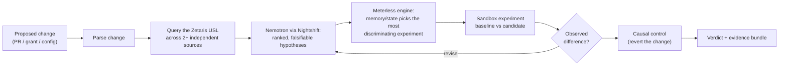
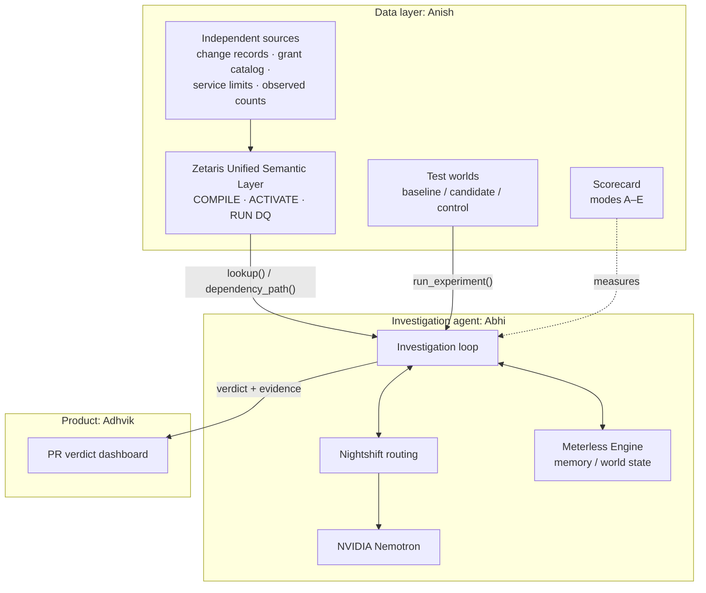

# Domino

**Domino finds the test nobody thought to write, runs it before deployment, and shows exactly what would break, with evidence rather than a guess.**

Domino is an autonomous, evidence-first **pre-deployment failure investigation engine**. Given a proposed change (a pull request, schema migration, permission grant or config edit), it joins the facts about that change that are scattered across separate systems. It works out which hidden cross-system assumptions the change could break. Then it proves or rules out each one with a controlled experiment in a disposable sandbox, before anyone deploys.

| | |
|---|---|
| **Event** | GenAI.Works Open Agent Hackathon 2026 |
| **Track** | Track 1: Solving Fragmented Intelligence |
| **Build window** | 22–27 October 2026 |
| **Deadline** | Tue 27 Oct 2026, 23:45 UTC |
| **Team** | Anish Alleti · Abhi Jandyala · Adhvik Vala |
| **Status** | 🚧 In active development. Code lives on the team branches until the planned merges (see [Team and branches](#team-and-branches)). |

> No performance claims are made here until the scorecard has measured them. Sections marked **TODO** are filled in as the build lands.

---

## Contents
- [The problem](#the-problem)
- [What Domino does](#what-domino-does)
- [How it works](#how-it-works)
- [System architecture](#system-architecture)
- [Why Track 1](#why-track-1)
- [How Domino differs from existing tools](#how-domino-differs-from-existing-tools)
- [Sponsor technology](#sponsor-technology)
- [Evaluation](#evaluation)
- [Getting started](#getting-started)
- [Repository structure](#repository-structure)
- [Team and branches](#team-and-branches)
- [Safety, privacy and data](#safety-privacy-and-data)
- [Limitations](#limitations)
- [Roadmap](#roadmap)
- [Disclosures](#disclosures)

---

## The problem

Software teams test the file they changed. Catastrophic incidents often start in a system nobody thought to test, because the change was **correct in isolation and disastrous in combination**.

- **Cloudflare, 18 November 2025.** A database permissions change altered the output of a metadata query. A generated file grew past a downstream consumer's limit. ([official postmortem](https://blog.cloudflare.com/18-november-2025-outage/))
- **CrowdStrike, July 2024.** A content update and the component interpreting it disagreed about how many input fields existed. ([official root-cause analysis](https://www.crowdstrike.com/wp-content/uploads/2024/08/Executive-Summary_Root-Cause-Analysis_Channel-File-291.pdf))

In both incidents, no single artifact held the whole causal chain. The change was in one place, the permissions in another, the generator's behaviour in code, the consumer's limit in configuration and the actual data volumes in telemetry. Connecting them took a person who already knew where to look.

## What Domino does

An engineer opens a high-impact change. Domino:

1. **Reads the change** and identifies what it touches.
2. **Connects the context.** It joins code-level facts with permissions, configuration limits and observed data through a unified semantic layer, keeping provenance for every fact.
3. **Hypothesizes** specific, falsifiable downstream consequences.
4. **Experiments.** It runs the baseline and the candidate side by side in an isolated environment, changing exactly one thing.
5. **Proves or rules out** each hypothesis, then runs a causal control that reverts the change.
6. **Reports** a conservative verdict with a reproducible evidence bundle.

| Verdict | Means |
|---|---|
| **Reproduced failure** | baseline passed, candidate failed, the causal control passed again, and the run is reproducible |
| **No failure observed** | nothing broke *under the exact conditions listed*; this is never a claim of production safety |
| **Inconclusive** | the available context or sandbox fidelity was not enough to decide |

The deliverable is not "AI says your code is risky". It is an **evidence bundle**:
- the change
- system versions
- the dependency path with source row IDs
- experiment parameters
- baseline and candidate outcomes
- logs and hashes
- model-routing receipts
- a suggested mitigation

## How it works



Every investigation is bounded by a cap on steps, model calls and wall-clock time.

**Boundaries of autonomy**
- **Deterministic assertions decide pass/fail.** The language model plans experiments and explains results; it cannot mark anything "verified".
- **No raw shell, no secrets.** A typed tool gateway allowlists every call and enforces argument schemas, targets, quotas and timeouts.
- **Read-only context.** Domino reads the semantic layer as a non-admin, read-only user. It writes only inside disposable sandboxes.
- **Two-source rule.** Every reported risk must rest on at least two independently sourced facts connected in the semantic layer. Each link is labelled *observed*, *inferred* or *unresolved*.

## System architecture



| Component | Responsibility | Owner |
|---|---|---|
| **Data layer** | Zetaris USL over independent sources, data-quality rules, provenance-preserving lookups, sample mode | Anish |
| **Test worlds** | Small, safe, local systems that really break under a specific change; one uniform experiment interface | Anish |
| **Scorecard** | Honest measurement against simpler baselines | Anish |
| **Investigation agent** | Hypothesis generation, experiment selection and revision through Nightshift-routed Nemotron; Meterless memory/state | Abhi |
| **Product and story** | PR-verdict dashboard, documentation, deck, demo video, submission | Adhvik |

The components meet only at agreed interfaces. The data-layer contract defines `lookup`, `dependency_path`, `run_experiment` and `describe_world`; it is on the `anishalleti` branch at `contracts/README.md`.

## Why Track 1

Track 1 is about **fragmented intelligence**: joining disconnected sources into an actionable, source-grounded model. That is Domino's core move. The PR diff is in GitHub, contracts are in source, permissions are in a catalog, limits are in configuration and real usage is in telemetry. **No single source proves the cross-system consequence.** A semantic join across them raises the question, and the sandbox experiment answers it.

## How Domino differs from existing tools

| Existing tools | What they do | Domino |
|---|---|---|
| Incident RCA (e.g. Datadog Bits Investigation) | Correlate production signals after an incident | Forms hypotheses **before** the change ships and tests them in isolation |
| Release assurance (e.g. Datadog Bits Release, Harness) | Validate a change **after** deployment | Generates and runs targeted experiments pre-deployment |
| Infrastructure planning (Terraform plan) | Shows declared resource changes | Investigates application behaviour a resource plan does not express |
| CI / affected-test selection | Runs tests developers already wrote | Infers **missing** producer–consumer contracts and builds the test nobody wrote |
| SAST / DAST / contract tests | Check known rule classes | Chooses the right experiment from newly correlated cross-system evidence |

The claimed novelty is a hypothesis until measured: an agent that discovers an **unexpressed cross-system invariant** and constructs the experiment that exposes its violation. The scorecard exists to test that claim.

## Sponsor technology

| Technology | Role | Proof of real use |
|---|---|---|
| **Zetaris** | Joins 2+ independent sources into a compiled, queryable Unified Semantic Layer; data-quality rules catch broken joins | Source tables, `COMPILE USL` result, USL query rows with source IDs, `RUN DQ` output, full query log |
| **Meterless Engine** | Memory/world state that changes a later investigation's test plan | Saved state → later retrieval → changed action (**TODO**) |
| **Nightshift** | Primary model-inference router | Call traces and signed routing receipts (**TODO**) |
| **NVIDIA Nemotron** | Reasons over dependencies and chooses discriminating experiments | Receipts show `routed_model` = Nemotron for each call (**TODO**) |
| **Claude Code** | Development assistant (not part of the running product) | Disclosed below |

## Evaluation

Domino is measured on **10–15+ labelled cases**:
- **failure worlds** modelled on the public incident mechanisms above
- **at least one held-out "surprise" world** from a different failure family, kept away from agent development
- **at least one safe change** that looks risky but breaks nothing
- **variants**: different numbers, near-misses and fixed versions

It is compared against simpler versions of itself:

| Mode | Description |
|---|---|
| **A** | Static checks only. Same schemas, no inferred cross-source links. |
| **B** | Nemotron alone. No tools. |
| **C** | Nemotron with full retrieved context but no experiments. |
| **D** | **Full Domino.** |
| **E** | Full Domino with the semantic layer hidden. Does Zetaris actually help? |

**Metrics:**
- failures caught (recall)
- false alarms on safe changes
- whether the stated cause matches the true mechanism
- share of warnings backed by a reproduced failure
- runtime
- model calls

**Rules:**
- Repeat runs must be truly independent.
- Model-provider outages are recorded separately from wrong answers.
- Sample sizes are always reported, and numbers are never rounded up or invented.

**Results: TODO.** Filled in from the frozen scorecard run.

## Getting started

> **Current state:** `main` holds only this overview. Working code is on the team branches until the planned merge checkpoints.

```bash
git clone https://github.com/alleti01/Domino.git
cd Domino
git branch -a
```

**For judges and reviewers (TODO):** a one-command **sample mode** that runs the full pipeline from a fresh clone with **no Zetaris installation and no API keys**, replaying saved semantic-layer query results. There will also be instructions for pointing Domino at your own Zetaris instance with a schema and seed script.

**For developers:**
- the data layer needs only Python 3.9+, with no third-party packages
- live mode needs a local Zetaris (Docker) plus Nightshift access for the agent
- setup instructions land with each component

## Repository structure

Planned layout after the branches merge:

```
.
├── README.md            this overview
├── contracts/           interfaces between components (data layer ↔ agent)
├── data_layer/          Zetaris client, lookups, experiment runner, evidence log
├── zetaris/             synthetic sources, USL / DQ / grants SQL, sample-mode snapshots
├── worlds/              runnable test worlds (neutral names, no hints)
├── ground_truth/        expected verdicts: scorecard only, never read by the agent
├── scorecard/           evaluation harness (modes A–E)
├── <agent>/             investigation loop, Nightshift / Nemotron / Meterless (TODO)
└── <dashboard>/         PR-verdict UI (TODO)
```

## Team and branches

| Person | Branch | Area |
|---|---|---|
| **Anish Alleti** | `anishalleti` | Data layer, Zetaris USL, test worlds, scorecard |
| **Abhi Jandyala** | `abhijandyala` | Investigation agent: Nightshift, Nemotron, Meterless Engine |
| **Adhvik Vala** | `adhvikvala` | Dashboard, documentation, deck, demo video, submission |

- Everyone works on their own branch. **Nothing merges into `main` until the team agrees.**
- Each person stays in their own area. Cross-component changes go through `contracts/`.

**Planned merge checkpoints:**

| When | Milestone |
|---|---|
| Sat 24 Oct, midday | First test world runs (baseline passes, candidate fails). Semantic layer live over 2+ sources. Agent calls the real data-layer interfaces. |
| Sun 25 Oct, evening | All worlds, surprise and safe cases done. Data-quality demo working. Scorecard runs end to end. **Working product.** |
| Mon 26 Oct, night | Final numbers and sample-mode snapshots frozen. Documentation and video assets handed off. |
| Tue 27 Oct | Buffer. Submit well before 23:45 UTC. |

## Safety, privacy and data

- **Synthetic data only.** Every test world and data source is synthetic, created for this project and labelled as such. There is no real customer, personal or confidential data.
- **Least privilege.** The semantic layer is read through a non-admin, read-only account. Admin access is used only by setup scripts.
- **No secrets in the repo.** Credentials live in local, gitignored env files, and examples contain placeholders only.
- **Bounded and isolated execution.** Timeouts on every external call, capped retries, sandboxed experiments with no network egress.
- **Prompt-injection hygiene.** Retrieved text is treated as evidence, never as instructions.
- **Model-provider ports** are never exposed publicly.

## Limitations

- A test world reconstructs a failure **mechanism**, not the original production system. Passing an experiment is not a guarantee of production safety.
- A semantic layer is not automatically a complete causal graph: keys can be missing and identities can collide. Domino reports that uncertainty instead of hiding it.
- Model latency through the routing layer can reach tens of seconds per call, so investigations are deliberately short.
- The hackathon build covers a bounded set of failure families, not arbitrary enterprise systems.
- **TODO:** limitations found by the scorecard.

## Roadmap

Each step is driven by measured shortcomings, not assumptions:
- connectors for GitHub, OpenTelemetry, cloud inventory, database catalogs and CI/CD artifacts
- more realistic experiments: sanitized representative datasets, deterministic replay, service virtualization
- fewer false positives through calibration, causal controls and selective human review
- deployment the customer controls, with private open-weight model inference
- pilots with consenting design partners on staging environments
- new failure families (idempotency, schema compatibility, config scope, cross-service authorization), added only after benchmark gains

## Disclosures

- **Built during the event (22–27 October 2026).** **TODO:** list anything that existed before 22 October, if any.
- **Synthetic data:** all data in this repository is synthetic.
- **Reference material:** Zetaris's public [getting-started](https://github.com/zetaris/getting-started) repository was used as setup documentation. No code from it is vendored.
- **AI assistance:** Claude Code was used as a development assistant.
- **License:** **TODO.**
